# ⚡ Awesome Real-Time Interaction Management (RTIM)

<p align="center">
  
</p>

<p align="center">
  <a href="https://github.com/ishandutta2007/Awesome-Awesome-Awesome"></a>
  <a href="https://discord.gg/jc4xtF58Ve"></a>
  <a href="https://github.com/ishandutta2007/Awesome-Real-Time-Interaction-Management-Rtim/stargazers"></a>
  <a href="https://github.com/ishandutta2007/Awesome-Real-Time-Interaction-Management-Rtim/network/members"></a>
  <a href="https://github.com/ishandutta2007/Awesome-Real-Time-Interaction-Management-Rtim/issues"></a>
  <a href="https://github.com/ishandutta2007/Awesome-Real-Time-Interaction-Management-Rtim/blob/main/LICENSE"></a>
  <a href="https://github.com/ishandutta2007"></a>
</p>

---

## 📖 Overview & SEO Summary

**Real-Time Interaction Management (RTIM)** software enables enterprise growth teams, customer experience (CX) engineers, and data platforms to orchestrate context-aware customer journeys in sub-50ms latency. By fusing behavioral signals, identity resolution, machine learning propensity scoring, and business logic, RTIM systems determine and execute the **Next-Best-Action (NBA)** across web, mobile apps, email, outbound messaging, service desks, and physical POS endpoints.

This curated list gathers top enterprise SaaS platforms, emerging growth engines, and production-ready open-source components for building self-hosted, data-sovereign real-time decisioning infrastructure.

---

## 📑 Table of Contents

- [🌐 Sector Overview & Market Dynamics](#-sector-overview--market-dynamics)
- [🏢 SaaS & Hosted Enterprise Platforms](#-saas--hosted-enterprise-platforms)
- [🔓 Open-Source GitHub Projects](#-open-source-github-projects)
- [🛠️ Architectural Stacks & Custom Implementations](#️-architectural-stacks--custom-implementations)
- [🤝 How to Contribute](#-how-to-contribute)
- [💖 Support & Sponsorship](#-support--sponsorship)
- [📈 Star History](#-star-history)
- [📜 Disclaimer](#-disclaimer)

---

## 🌐 Sector Overview & Market Dynamics

The global Real-Time Interaction Management (RTIM) and Next-Best-Action market is estimated at **$2.5 billion to $3.2 billion** and is projected to expand at a compound annual growth rate (**CAGR**) of over **18.5%** through 2032, propelled by real-time customer data platforms (CDPs) and in-session generative AI decisioning.

The sector is **moderately fragmented with strong polarization**: enterprise tier-1 deployments remain concentrated among legacy customer experience behemoths (Salesforce, Adobe, Pegasystems, SAS) that command high ACVs through deeply coupled enterprise stacks, while modern digital-native commerce and product teams increasingly assemble best-of-breed or data-sovereign open-source stacks using real-time feature stores, vector retrieval engines, and composable experimentation platforms.

---

## 🏢 SaaS & Hosted Enterprise Platforms

Enterprise SaaS platforms evaluated by company scale (revenue / market valuation), exact starting tier pricing, and transparent free tier or trial terms.

| 🏢 Platform | 💰 Starting Price | 🎁 Free Tier Limit / Trial Duration | 💼 Key RTIM Capabilities | 📊 Company Scale (Valuation / Revenue) |
| :--- | :--- | :--- | :--- | :--- |
| [**Salesforce Marketing Cloud Personalization**](https://www.salesforce.com/products/marketing-cloud/personalization/) *(Interaction Studio)* | **$1,250 / org / month** (Starting Growth Tier, annual contract) | **30-day guided sandbox demo trial** (Custom demo org access upon sales qualification) | Omnichannel next-best-action decisioning, in-session predictive intent scoring, and automated journey triggers across web, app, and email. | **~$280B Market Cap** (~$35B+ Annual Revenue) |
| [**Adobe Target**](https://business.adobe.com/products/target/adobe-target.html) | **$1,500 / month** (~$18,000/year base tier, based on annual pageview commitment) | **No self-service free tier; 14-day assisted enterprise proof-of-concept trial** | Algorithmic automated personalization (Auto-Target), multi-armed bandit testing, server-side decision APIs, and Experience Cloud integration. | **~$220B Market Cap** (~$21B+ Annual Revenue) |
| [**Pegasystems Customer Decision Hub**](https://www.pega.com/products/customer-decision-hub) | **$2,500 / month** (Typical enterprise entry subscription starting at ~$30,000/year) | **30-day full Pega Cloud Trial** (Includes preconfigured Customer Decision Hub business sandbox) | Enterprise "Always-on Brain" executing AI-driven 1:1 next-best-actions, real-time arbitration, contact policy governance, and retention workflows. | **~$6.5B Market Cap** (~$1.4B Annual Revenue) |
| [**SAS Real-Time Decision Manager**](https://www.sas.com/en_us/software/real-time-decision-manager.html) | **$2,000 / month** (Base enterprise deployment starting at ~$24,000/year) | **14-day guided evaluation sandbox** (Available via SAS Customer Intelligence 360 trial program) | High-throughput sub-millisecond scoring, transactional fraud/credit cross-sell arbitration, and deterministic business logic orchestration. | **Private Enterprise** (~$3.2B Annual Revenue) |
| [**Sitecore Discover**](https://www.sitecore.com/products/discover) *(formerly Reflektion)* | **$1,800 / month** (Entry commerce package, billed annually) | **14-day guided proof-of-concept environment** (Interactive demo sandbox with sample catalog data) | Real-time predictive search, in-session 1:1 commerce merchandising, automated product recommendations, and behavioral affinity re-ranking. | **~$1.6B Valuation** (Private / EQT-backed, ~$450M+ Revenue) |
| [**Bloomreach Personalization**](https://www.bloomreach.com/en/products/engagement) *(Engagement & Discovery)* | **$1,000 / month** (Bloomreach Engagement starter plan based on tracked profiles) | **14-day free trial** (Full feature access with up to 10,000 tracked profiles and sandbox data) | Real-time customer data engine, automated cross-channel marketing orchestration, dynamic web personalization, and commerce search reranking. | **~$2.2B Valuation** (~$180M+ ARR) |
| [**Dynamic Yield**](https://www.dynamicyield.com/) *(Mastercard)* | **$1,200 / month** (Starting tier for mid-market sites based on monthly impressions) | **30-day pilot proof-of-concept program** (Structured trial for qualified enterprise commerce teams) | Contextual multi-armed bandit recommendation algorithms, dynamic client-side and server-side testing, and real-time behavioral segmentation. | **Acquired by Mastercard** ($300M+ acquisition; Mastercard ~$450B Market Cap) |
| [**Insider**](https://useinsider.com/) | **$699 / month** (Growth tier starting price based on active monthly user tiers) | **14-day interactive trial** (Guided onboarding sandbox with pre-built customer journey templates) | AI-powered individualized customer journey orchestration, cross-channel messaging (WhatsApp, SMS, Web Push), and predictive churn scoring. | **~$2.0B Valuation** (Unicorn, ~$150M+ ARR) |
| [**Redpoint rgOne**](https://www.redpointglobal.com/) | **$2,500 / month** (Enterprise hub starting subscription, billed annually) | **30-day enterprise evaluation POC** (Includes automated identity resolution and decision testbench) | Automated real-time identity resolution, cross-channel interaction arbitration, and sub-second next-best-action decision routing across legacy systems. | **Private Enterprise** (~$60M+ Annual Revenue) |
| [**Thunderhead ONE**](https://www.thunderhead.com/) *(Medallia)* | **$1,500 / month** (Starting interaction orchestration module, billed annually) | **14-day guided cloud sandbox** (Available upon request via Medallia solutions engineering) | Continuous adaptive omnichannel journey listening, conversational context tracking, and real-time intervention triggers for web and call center. | **Acquired by Medallia** (~$6.4B Thoma Bravo take-private transaction) |

---

## 🔓 Open-Source GitHub Projects

Explore the top open-source projects providing building blocks for Real-Time Interaction Management—ranging from vector memory and analytics to contextual recommendation engines, feature flags, and event orchestration.

Sorted by **GitHub Star Count** (descending):

| 📦 Repository & Project | ⭐ GitHub Stars | ⚖️ License | 📝 Description & RTIM Architectural Role |
| :--- | :--- | :--- | :--- |
| [**milvus-io/milvus**](https://github.com/milvus-io/milvus) | [](https://github.com/milvus-io/milvus/stargazers) | Apache-2.0 | High-performance, cloud-native vector database built for massive-scale semantic similarity search and millisecond recommendation candidate generation. |
| [**PostHog/posthog**](https://github.com/PostHog/posthog) | [](https://github.com/PostHog/posthog/stargazers) | MIT | All-in-one developer platform featuring real-time product analytics, session replay, feature flags, user cohort segmentation, and client/server-side experiment rollout. |
| [**novuhq/novu**](https://github.com/novuhq/novu) | [](https://github.com/novuhq/novu/stargazers) | Apache-2.0 | Open-source notification infrastructure enabling automated, event-driven multi-channel message delivery (Push, Email, In-App, SMS, Chat) in reaction to real-time decisions. |
| [**chatwoot/chatwoot**](https://github.com/chatwoot/chatwoot) | [](https://github.com/chatwoot/chatwoot/stargazers) | AGPL-3.0 | Omnichannel customer communication desk integrating live chat, email, and social messaging to empower human agents with live customer context and next-best actions. |
| [**qdrant/qdrant**](https://github.com/qdrant/qdrant) | [](https://github.com/qdrant/qdrant/stargazers) | Apache-2.0 | Ultra-fast vector similarity engine and payload filter in Rust, designed for sub-10ms real-time personalized search and recommendation retrieval. |
| [**plausible/analytics**](https://github.com/plausible/analytics) | [](https://github.com/plausible/analytics/stargazers) | AGPL-3.0 | Lightweight, privacy-compliant, cookie-free web analytics service capturing real-time user intent signals and page engagement events. |
| [**recommenders-team/recommenders**](https://github.com/recommenders-team/recommenders) | [](https://github.com/recommenders-team/recommenders/stargazers) | MIT | Microsoft-originated library containing production-grade algorithms, evaluation utilities, and operational pipelines for recommendation systems. |
| [**weaviate/weaviate**](https://github.com/weaviate/weaviate) | [](https://github.com/weaviate/weaviate/stargazers) | BSD-3-Clause | Cloud-native vector search engine capable of combining semantic vector search with structured relational filters for personalized offer retrieval. |
| [**unleash/unleash**](https://github.com/unleash/unleash) | [](https://github.com/unleash/unleash/stargazers) | Apache-2.0 | Battle-tested enterprise feature management platform providing real-time gradual rollouts, canary deployments, and user-targeted experiment flags. |
| [**gorse-io/gorse**](https://github.com/gorse-io/gorse) | [](https://github.com/gorse-io/gorse/stargazers) | Apache-2.0 | AI-driven recommender engine written in Go that automatically ingests user-item interaction telemetry, trains collaborative filtering models, and serves REST recommendations. |
| [**growthbook/growthbook**](https://github.com/growthbook/growthbook) | [](https://github.com/growthbook/growthbook/stargazers) | MIT | Modern experimentation and feature flagging engine featuring sequential testing, CUPED variance reduction, Bayesian stats, and multi-armed bandit optimization. |
| [**feast-dev/feast**](https://github.com/feast-dev/feast) | [](https://github.com/feast-dev/feast/stargazers) | Apache-2.0 | Leading open-source feature store for AI/ML that manages offline training features and serves ultra-low latency online features to real-time decision models. |
| [**flagsmith/flagsmith**](https://github.com/flagsmith/flagsmith) | [](https://github.com/flagsmith/flagsmith/stargazers) | BSD-3-Clause | Feature flag and remote configuration platform with identity-level user segmentation and on-premise self-hosting capabilities. |
| [**flipt-io/flipt**](https://github.com/flipt-io/flipt) | [](https://github.com/flipt-io/flipt/stargazers) | GPL-3.0 | High-performance, Git-native feature flagging solution written in Go with sub-millisecond evaluation latency for high-throughput interaction gates. |
| [**rudderlabs/rudder-server**](https://github.com/rudderlabs/rudder-server) | [](https://github.com/rudderlabs/rudder-server/stargazers) | SSPL | Enterprise open-source Customer Data Platform (CDP) for capturing, routing, and transforming behavioral clickstream telemetry in real time. |
| [**facebookresearch/ReAgent**](https://github.com/facebookresearch/ReAgent) | [](https://github.com/facebookresearch/ReAgent/stargazers) | BSD-3-Clause | Meta's open-source modular framework for applied reinforcement learning and contextual bandit decision systems in high-scale interaction environments. |
| [**dittofeed/dittofeed**](https://github.com/dittofeed/dittofeed) | [](https://github.com/dittofeed/dittofeed/stargazers) | MIT | Open-source customer engagement platform featuring drag-and-drop journey orchestration, dynamic user segments, and event-driven transactional messaging. |
| [**laudspeaker/laudspeaker**](https://github.com/laudspeaker/laudspeaker) | [](https://github.com/laudspeaker/laudspeaker/stargazers) | AGPL-3.0 | Omnichannel customer onboarding and engagement platform; visual journey builder triggering automated emails, SMS, push notifications, and in-app banners. |
| [**metarank/metarank**](https://github.com/metarank/metarank) | [](https://github.com/metarank/metarank/stargazers) | Apache-2.0 | Low-code machine learning ranking service that personalizes search results, article feeds, and e-commerce listings with 10–20ms reranking latency. |
| [**allegro/hermes**](https://github.com/allegro/hermes) | [](https://github.com/allegro/hermes/stargazers) | Apache-2.0 | Asynchronous, resilient message broker built over Apache Kafka, ensuring guaranteed delivery of user interaction events across microservices. |
| [**bucketeer-io/bucketeer**](https://github.com/bucketeer-io/bucketeer) | [](https://github.com/bucketeer-io/bucketeer/stargazers) | Apache-2.0 | Feature management and experimentation platform providing real-time user-targeted experiments, metrics evaluation, and flag auditing without scale limits. |

---

## 🛠️ Architectural Stacks & Custom Implementations

When engineering a modern, privacy-compliant, data-sovereign Real-Time Interaction Management system, production teams combine the following architectural tiers:

```
[ Inbound Touchpoint ] (Web, Mobile App, Contact Center, POS)
         │  (Sub-30ms Event Stream)
         ▼
[ Real-Time Ingestion / CDP ] ────────► RudderStack / Clickstream Telemetry
         │
         ▼
[ Feature & State Store ] ────────────► Feast (Real-Time ML Features) + Redis (Session Context)
         │
         ▼
[ Candidate Retrieval & Scoring ] ────► Milvus / Qdrant (Vector Embeddings) + Metarank / Gorse
         │
         ▼
[ Decision Arbitration & Policy ] ────► ReAgent (Bandits) + GrowthBook (Experimentation / A/B Gates)
         │
         ▼
[ Next-Best-Action Execution ] ───────► Dittofeed / Novu / Laudspeaker (Omnichannel Delivery)
```

1. **Telemetry & Identity**: Real-time event ingestion via [RudderStack](https://github.com/rudderlabs/rudder-server) or [PostHog](https://github.com/PostHog/posthog).
2. **Context & Feature Cache**: Low-latency feature serving using [Feast](https://github.com/feast-dev/feast) backed by Redis or PostgreSQL.
3. **Candidate Generation**: Semantic similarity retrieval using [Qdrant](https://github.com/qdrant/qdrant) or [Milvus](https://github.com/milvus-io/milvus).
4. **Ranking & Arbitration**: Learn-to-rank scoring with [Metarank](https://github.com/metarank/metarank) and bandit policies with [ReAgent](https://github.com/facebookresearch/ReAgent).
5. **Experimentation Guardrails**: Statistical gates and variant routing through [GrowthBook](https://github.com/growthbook/growthbook) or [Unleash](https://github.com/unleash/unleash).
6. **Execution & Delivery**: Multichannel orchestration using [Dittofeed](https://github.com/dittofeed/dittofeed) or [Novu](https://github.com/novuhq/novu).

---

## 🤝 How to Contribute

Contributions are warmly welcomed! Help keep this curated landscape up to date:

1. 🍴 **Fork the repository** to your GitHub profile.
2. 🌿 **Create a new branch** (`git checkout -b feature/add-rtim-platform`).
3. 📝 **Add your tool or platform** to the appropriate table, including verified pricing, free tier/trial details, and factual descriptions.
4. 🔍 **Verify links and metrics** before opening the PR.
5. 🚀 **Submit a Pull Request** with a descriptive summary of your changes.

---

## 💖 Support & Sponsorship

If you find this curated RTIM guide useful for your projects, architecture designs, or research, please consider supporting the project:

- ⭐ **Star this repository** to improve discoverability.
- 🍴 **Fork and share** it with your engineering and growth teams.
- ☕ **Sponsor or buy a coffee**: Support ongoing curation and open-source maintenance via the [**GitHub Sponsors Dashboard**](https://github.com/sponsors/ishandutta2007).

Thank you to all contributors and community sponsors! 🙌

---

## 📈 Star History

[](https://star-history.dera.page/#ishandutta2007/Awesome-Real-Time-Interaction-Management-Rtim&type=date&legend=top-left)

---

## 📜 Disclaimer

- This repository is a **community-curated guide** intended for architectural reference, educational purposes, and engineering research.
- All trademarks, service marks, company names, and product names cited herein belong to their respective owners.
- Real-Time Interaction Management deployments must strictly comply with applicable privacy and consumer protection laws (GDPR, CCPA/CPRA, HIPAA, consent preferences) and responsible AI governance.
